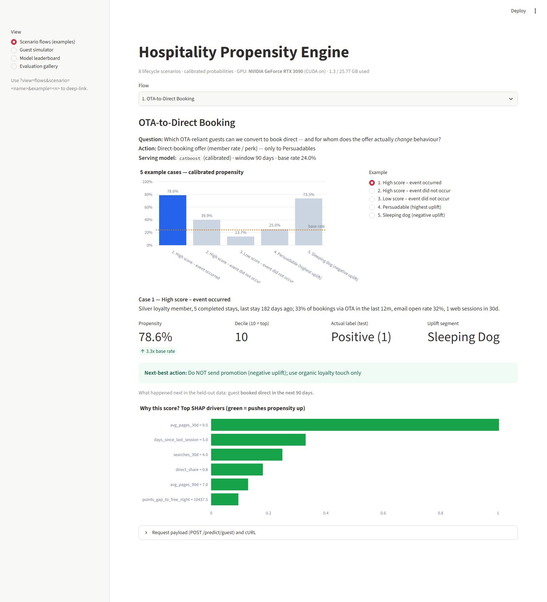
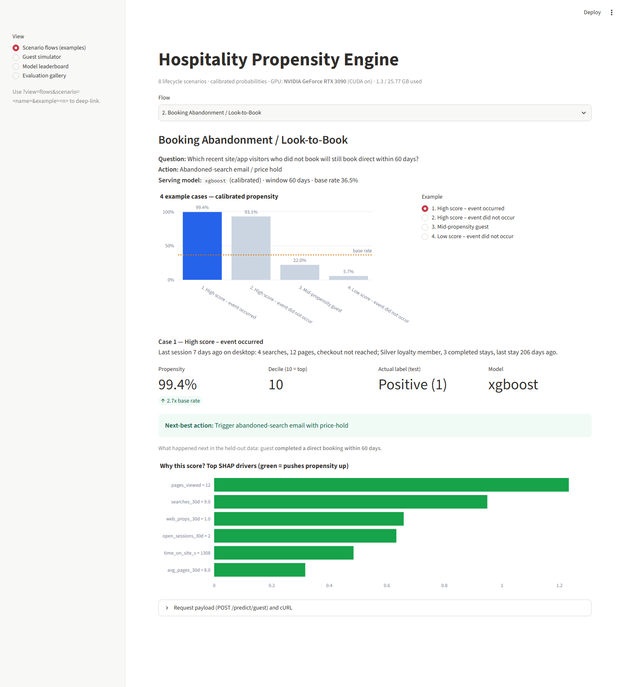
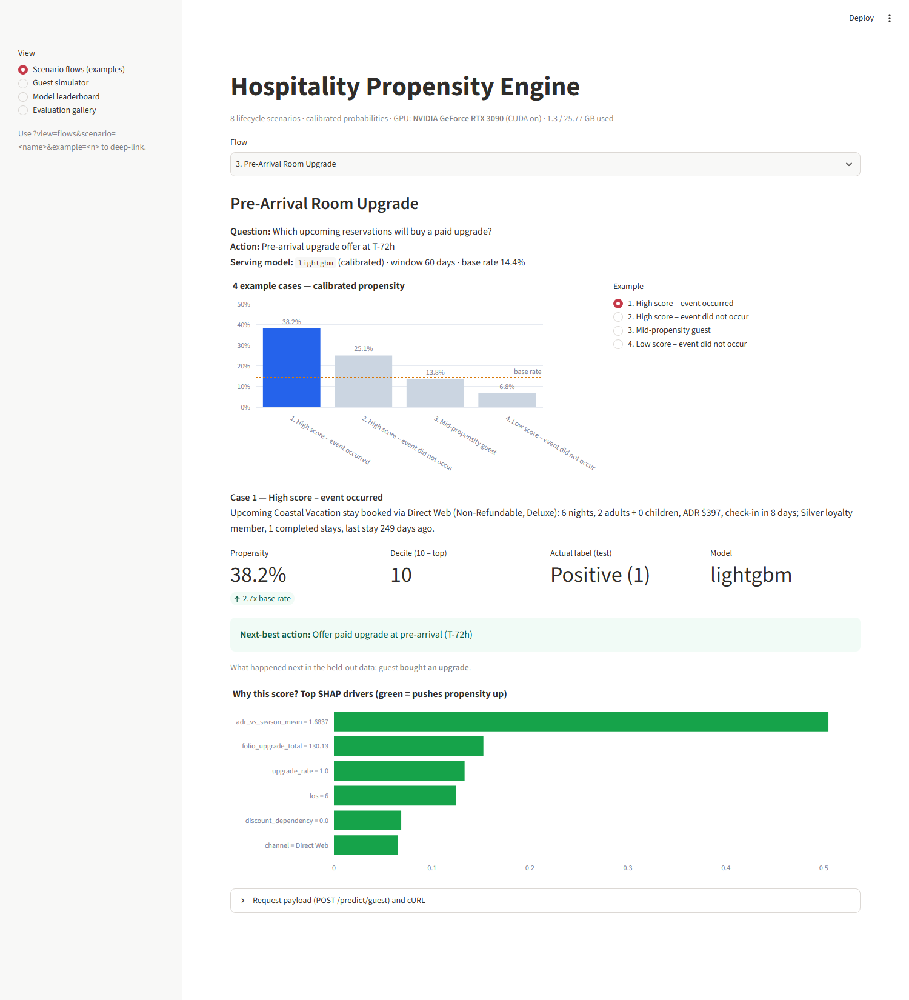
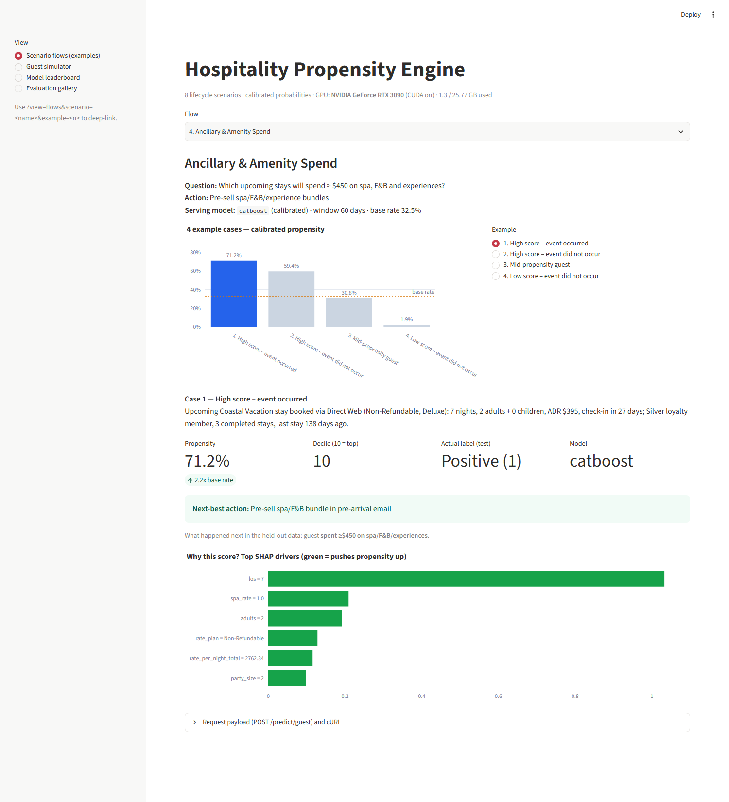
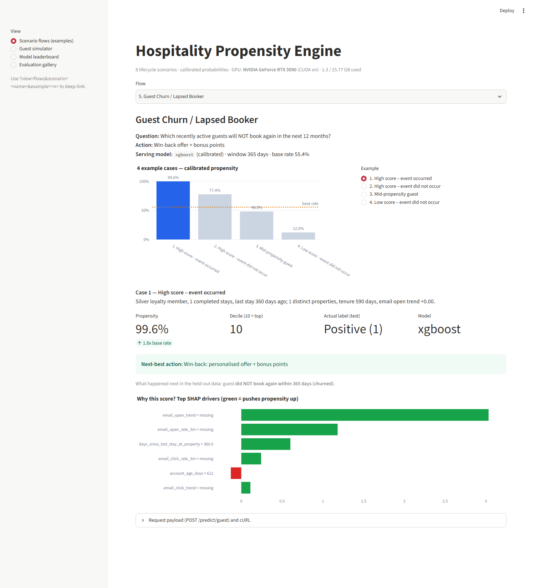
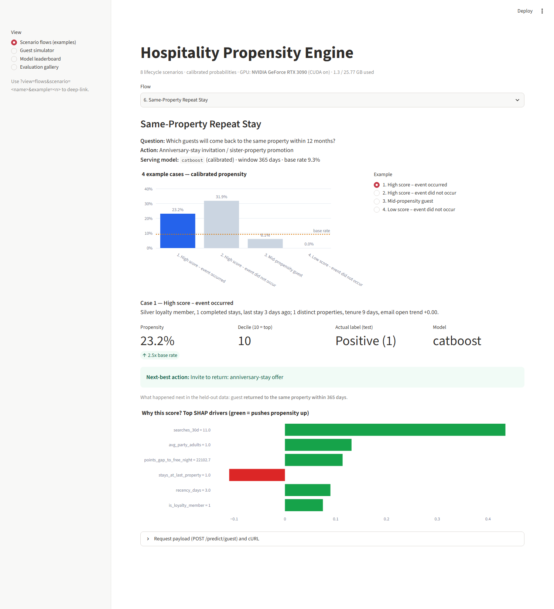
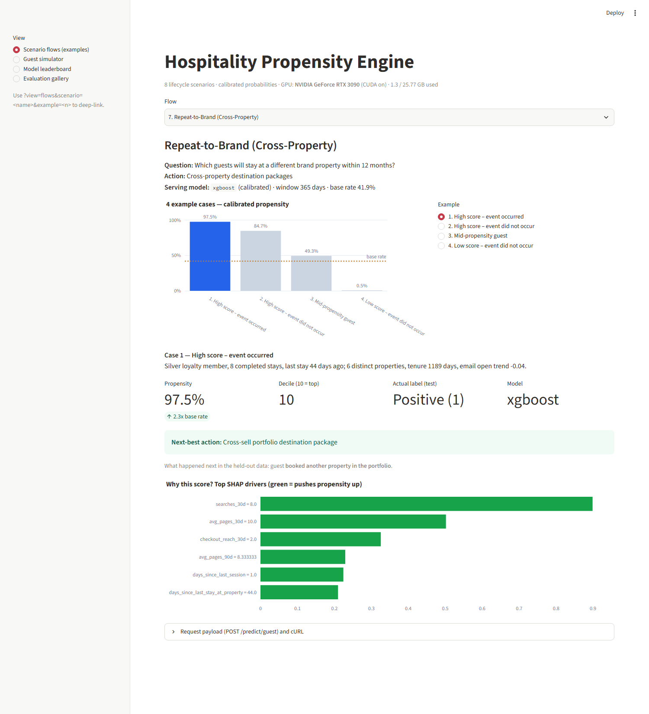
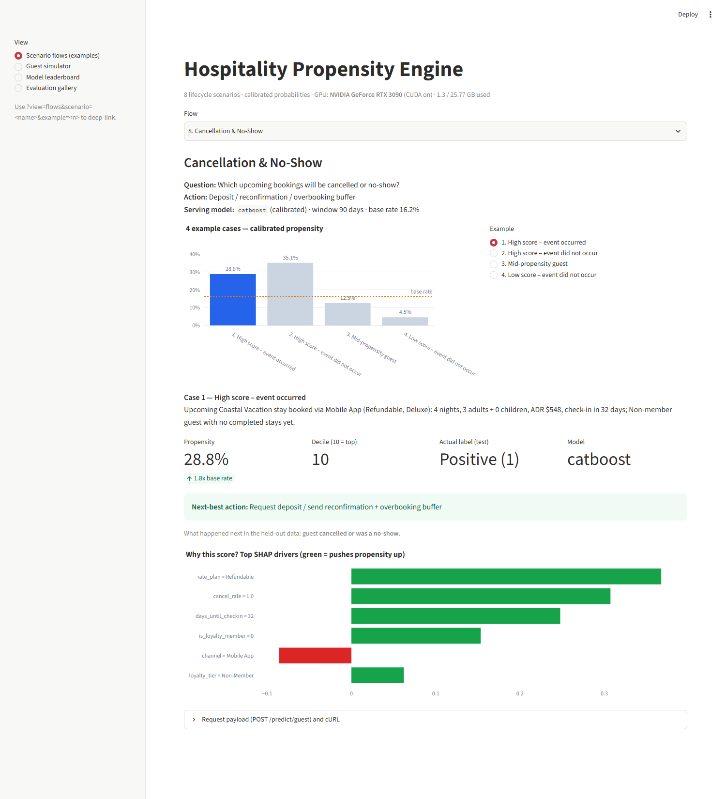

# Hospitality Propensity Engine

GPU-accelerated, end-to-end propensity modelling for **8 hospitality lifecycle scenarios**: synthetic relational data → point-in-time features → 4 model families per scenario (XGBoost, LightGBM, CatBoost, PyTorch NN) tuned with Optuna → calibrated probabilities → SHAP → FastAPI + Streamlit.
Everything below was executed on an **NVIDIA RTX 3090 (24 GB)**; the numbers are copied from `outputs/metrics/`.

> **Data is synthetic.** Outcomes come from a latent-trait generator, so the results show that the pipeline works and what it can do under known signal. They are **not** forecasts of real-world performance.

## Scenarios

| # | Scenario | Unit | Label window | Positive = | Test base rate |
|---|---|---|---|---|---|
| 1 | OTA-to-Direct (+ uplift) | guest with OTA history | 90d | books direct after campaign snapshot | 24.0% |
| 2 | Booking abandonment / look-to-book | last open web session | 60d | books direct within window | 36.5% |
| 3 | Pre-arrival room upgrade | upcoming booking | 60d | buys an upgrade | 14.4% |
| 4 | Ancillary & amenity spend | upcoming booking | 60d | spa+F&B+experiences ≥ $450 | 32.5% |
| 5 | Guest churn / lapsed booker | recently active guest | 365d | no booking in window | 55.4% |
| 6 | Same-property repeat | guest | 365d | re-books the last property | 9.3% |
| 7 | Repeat-to-brand | guest | 365d | books any *other* property | 41.9% |
| 8 | Cancellation & no-show | upcoming booking | 90d | cancelled or no-show | 16.2% |

## Architecture

```
configs/config.yaml        scenarios, windows, GPU flags, Optuna budget, next-best-action rules
src/data_generator.py      60k guests, 45 properties, 259k bookings, 243k folios, 489k web sessions, 1.4M email-months, surveys, complaints
src/feature_engineering.py point-in-time Snapshotter, per-scenario label builders, sklearn ColumnTransformer
src/models/                gbdt_models.py (XGB/LGBM/CatBoost) · deep_tabular.py (residual MLP) · uplift_model.py (T-Learner)
src/calibration.py         CalibratedClassifierCV(FrozenEstimator) – sigmoid vs isotonic chosen by held-out log-loss
src/trainer.py             Optuna (TPE + MedianPruner), group-aware stratified CV, calibration, GPU monitor, checkpoints
src/evaluator.py, explainer.py, predictor.py
api/                       FastAPI app + Pydantic schemas      dashboard/streamlit_app.py
src/make_examples.py       4-5 real held-out example guests per flow
tests/                     test_pipeline.py (28 tests) · capture_api_screenshots.py (Playwright)
```

**Leakage control.** Every feature is computed at a snapshot date `c` using only events observable before `c` (a booking's cancellation counts only if `cancel_date < c`; a stay is "completed" only if `checkout < c`). Labels come from `[c, c+window)`. Temporal split: train snapshots end at `val_cutoff − window`; validation snapshot = 2023-07-01; test snapshot = 2024-07-01, so label windows never overlap across splits. Tests enforce this, including a test that **deletes all post-cutoff data and verifies every feature is unchanged**, and a shuffled-label test (AUC ≈ 0.5).

**Training protocol per scenario × model.** Optuna, 15 trials, objective = validation PR-AUC (tuned on a sub-sample: ≤80k rows, ≤30k for CatBoost); 5-fold stratified-group CV (3 for CatBoost) reported; final fit on full train; validation is split by guest-hash into an early-stopping half and a calibration/model-selection half; calibration is fit on the calibration half only; all reported metrics are on the held-out test snapshot.

## Results: master leaderboard (test, calibrated)

Full table: `outputs/metrics/master_leaderboard.csv` (32 rows, adds Brier, ECE, CV, tuning time, GPU memory). Best model per scenario by *validation* PR-AUC is bolded.

| Scenario | Model | ROC-AUC | PR-AUC | LogLoss | Top-decile lift | Final fit (s) |
|---|---|---|---|---|---|---|
| OTA→Direct | XGBoost | 0.654 | 0.452 | 0.506 | 2.45 | 0.6 |
| | LightGBM (CPU) | 0.655 | 0.461 | 0.504 | 2.47 | 1.9 |
| | **CatBoost** | 0.656 | 0.458 | 0.505 | 2.48 | 2.0 |
| | PyTorch NN | 0.650 | 0.451 | 0.508 | 2.55 | 1.9 |
| Abandonment | **XGBoost** | 0.864 | 0.837 | 0.413 | 2.68 | 1.2 |
| | LightGBM (CPU) | 0.864 | 0.836 | 0.414 | 2.69 | 8.5 |
| | CatBoost | 0.864 | 0.837 | 0.413 | 2.68 | 4.6 |
| | PyTorch NN | 0.863 | 0.835 | 0.415 | 2.69 | 26.6 |
| Room upgrade | XGBoost | 0.654 | 0.245 | 0.393 | 1.98 | 1.0 |
| | **LightGBM (CPU)** | 0.657 | 0.241 | 0.393 | 2.01 | 0.8 |
| | CatBoost | 0.654 | 0.242 | 0.393 | 1.98 | 2.1 |
| | PyTorch NN | 0.658 | 0.245 | 0.392 | 2.06 | 3.9 |
| Ancillary | XGBoost | 0.753 | 0.573 | 0.538 | 2.05 | 0.8 |
| | LightGBM (CPU) | 0.754 | 0.571 | 0.538 | 2.04 | 0.6 |
| | **CatBoost** | 0.754 | 0.573 | 0.537 | 2.02 | 1.7 |
| | PyTorch NN | 0.741 | 0.555 | 0.547 | 2.02 | 1.6 |
| Churn | **XGBoost** | 0.832 | 0.885 | 0.464 | 1.80 | 0.7 |
| | LightGBM (CPU) | 0.830 | 0.884 | 0.468 | 1.80 | 1.0 |
| | CatBoost | 0.831 | 0.876 | 0.468 | 1.80 | 5.6 |
| | PyTorch NN | 0.823 | 0.870 | 0.481 | 1.80 | 1.7 |
| Property repeat | XGBoost | 0.803 | 0.313 | 0.253 | 3.67 | 0.5 |
| | **CatBoost** | 0.804 | 0.298 | 0.253 | 3.76 | 3.2 |
| | LightGBM (CPU) | 0.792 | 0.283 | 0.256 | 3.67 | 0.5 |
| | PyTorch NN | 0.774 | 0.289 | 0.261 | 3.64 | 2.7 |
| Brand repeat | **XGBoost** | 0.820 | 0.730 | 0.478 | 1.95 | 0.7 |
| | CatBoost | 0.819 | 0.720 | 0.480 | 1.94 | 9.2 |
| | LightGBM (CPU) | 0.818 | 0.719 | 0.480 | 1.95 | 0.8 |
| | PyTorch NN | 0.803 | 0.699 | 0.498 | 1.89 | 1.8 |
| Cancel / no-show | **CatBoost** | 0.730 | 0.345 | 0.398 | 2.66 | 2.9 |
| | XGBoost | 0.728 | 0.344 | 0.398 | 2.60 | 0.9 |
| | LightGBM (CPU) | 0.727 | 0.339 | 0.399 | 2.50 | 1.9 |
| | PyTorch NN | 0.707 | 0.326 | 0.406 | 2.46 | 5.9 |

**Reading this honestly**
- The three GBDTs are **statistically indistinguishable** in most scenarios (differences of ~0.001–0.01 PR-AUC, one test snapshot, no confidence intervals). Picking a "winner" by validation PR-AUC is reasonable but not strong evidence. The PyTorch NN is consistently equal or slightly worse, clearly so on churn, repeat and cancel.
- PR-AUC is not comparable across scenarios because base rates differ (churn's 0.885 sits against a 55% base rate). Use ROC-AUC and lift for cross-scenario comparison.
- Weakest signal: **OTA→Direct (ROC 0.65)** and **room upgrade (ROC 0.65)**.
- Churn and brand-repeat positive rates **shift between train and test** (churn 47% → 55%); calibration on the validation snapshot partly absorbs this.
- Calibration improved or matched test log-loss in 75% of the 32 models (sigmoid chosen for 24 models, isotonic for 8, all of the latter on the 365-day repeat/churn scenarios). In the other 25% (8 models: all four cancel/no-show, ancillary CatBoost/XGBoost, OTA→Direct NN, property-repeat XGBoost; each by ≤0.002 log-loss) the raw scores were already well calibrated and calibration made negligible or slightly negative differences. Before/after reliability plots are in `outputs/plots/calibration_*.png`.

## Key findings per scenario (SHAP, best tree model)

| Scenario | Top drivers |
|---|---|
| OTA→Direct | web browsing depth (`avg_pages_30d`, `searches_30d`), email open rate, season |
| Abandonment | `searches_30d`, pages viewed, open sessions in last 30d |
| Room upgrade | ADR vs property/season norm, channel, room type, LOS, children |
| Ancillary | length of stay, party size/adults, nightly rate, room type |
| Churn | email-open **trend** (3m vs 12m), email open rate, days since last stay at property |
| Same-property repeat | prior stays at the last property, email-open trend, points gap to free night |
| Brand repeat | email-open trend, email open rate, days since last stay |
| Cancel/no-show | **rate plan** (refundable), days until check-in, loyalty membership, channel |

Caveat: in this synthetic world email engagement decays after a guest's lifetime ends, so email-open trend is an unusually strong churn signal. In real data expect weaker, noisier engagement features.

## Uplift (OTA→Direct campaign, GPU XGBoost T-Learner)

A randomized 50/50 "direct-booking offer" was simulated at the snapshot (persuadables: OTA-affine, price-sensitive, low loyalty; mild negative effect for very loyal guests).
- **AUUC: 344.7 for T-Learner ranking vs 289.3 random vs 230.0 for ranking by baseline propensity**, so uplift ranking beats both; targeting by propensity alone is *worse than random* for incremental conversions.
- **The 4-way segmentation is only partly validated.** Realised treatment effect by segment on the test set: Persuadable +20.8 pp, Lost Cause +18.2 pp, Sure Thing +9.1 pp, Sleeping Dog +4.3 pp (expected negative). The ordering is directionally right, but Persuadable vs Lost Cause is not cleanly separated, and "Sleeping Dog" does not show a negative effect. Treat the segment labels as heuristics; the continuous uplift score ranks better than the buckets. See `outputs/plots/uplift_ota_to_direct.png`.

## GPU benchmarks (this machine)

| Model | Device used | Avg Optuna tuning / scenario (15 trials) | Avg final fit | Peak GPU memory* |
|---|---|---|---|---|
| XGBoost | CUDA `hist` | 11 s | 0.8 s | ~3.0 GB |
| LightGBM | **CPU (fallback)** | 12 s | 2.0 s | n/a |
| CatBoost | GPU | 105 s | 3.9 s | ~8.7 GB (`gpu_ram_part=0.25`) |
| PyTorch NN | CUDA + AMP fp16 | 53 s | 5.8 s | ~3.0 GB |

\*Whole-GPU memory from `nvidia-smi` polling (includes the driver/other processes' ~1.3 GB baseline), not the per-model allocation. Tuning used sub-sampled data and the early-stopping/pruning settings in `config.yaml`; times are not a controlled CPU-vs-GPU comparison, as no CPU baseline was run.

**LightGBM did not run on GPU.** The installed pip wheel reports "CUDA/GPU Tree Learner was not enabled in this build". `lightgbm_device()` probes `cuda`, then `gpu`, then falls back to CPU, logging a warning. A CUDA-enabled LightGBM build would be used automatically if installed.

## Streamlit walkthrough: all 8 flows with example guests

Open the dashboard and pick **Scenario flows (examples)**. Each flow has 4–5 *real held-out test cases* (full feature rows from `data/processed/<scenario>/test.parquet`, saved in `outputs/examples/examples.json`) chosen by score: high score where the event happened, high score where it did not (a false alarm), mid-score, and low score; OTA→Direct additionally shows the most *persuadable* and the most *negative-uplift* guest. For each case the page shows the calibrated propensity vs. the base rate, decile, next-best action, the actual test label, and the SHAP drivers. Deep link: `?view=flows&scenario=<name>&example=<n>`.

All 33 flow screenshots are in [`outputs/screenshots/streamlit/`](outputs/screenshots/streamlit/) (`flow_<scenario>_<n>.png`), plus `view_simulator.png`, `view_leaderboard.png`, `view_gallery.png`; API screenshots are in [`outputs/screenshots/api/`](outputs/screenshots/api/). Regenerate with `python -m src.make_examples` then `python tests/capture_api_screenshots.py`.

Scores are the calibrated probability from the serving model; "Actual" is the observed label in the test snapshot (for churn, *positive = churned*; for cancel/no-show, *positive = cancelled or no-show*).

### 1. OTA-to-Direct Booking

Serving model: `catboost` · base rate 24.0% · high-score action: *Send direct-booking offer: member rate + free breakfast*

| # | Example | Score | Actual | Screenshot |
|---|---|---|---|---|
| 1 | High score – event occurred | 78.6% | positive | [flow_ota_to_direct_1.png](outputs/screenshots/streamlit/flow_ota_to_direct_1.png) |
| 2 | High score – event did not occur | 39.9% | negative | [flow_ota_to_direct_2.png](outputs/screenshots/streamlit/flow_ota_to_direct_2.png) |
| 3 | Low score – event did not occur | 13.7% | negative | [flow_ota_to_direct_3.png](outputs/screenshots/streamlit/flow_ota_to_direct_3.png) |
| 4 | Persuadable (highest uplift) | 25.0% | negative | [flow_ota_to_direct_4.png](outputs/screenshots/streamlit/flow_ota_to_direct_4.png) |
| 5 | Sleeping dog (negative uplift) | 73.5% | positive | [flow_ota_to_direct_5.png](outputs/screenshots/streamlit/flow_ota_to_direct_5.png) |



### 2. Booking Abandonment / Look-to-Book

Serving model: `xgboost` · base rate 36.5% · high-score action: *Trigger abandoned-search email with price-hold*

| # | Example | Score | Actual | Screenshot |
|---|---|---|---|---|
| 1 | High score – event occurred | 99.4% | positive | [flow_booking_abandonment_1.png](outputs/screenshots/streamlit/flow_booking_abandonment_1.png) |
| 2 | High score – event did not occur | 93.3% | negative | [flow_booking_abandonment_2.png](outputs/screenshots/streamlit/flow_booking_abandonment_2.png) |
| 3 | Mid-propensity guest | 22.0% | negative | [flow_booking_abandonment_3.png](outputs/screenshots/streamlit/flow_booking_abandonment_3.png) |
| 4 | Low score – event did not occur | 5.7% | negative | [flow_booking_abandonment_4.png](outputs/screenshots/streamlit/flow_booking_abandonment_4.png) |



### 3. Pre-Arrival Room Upgrade

Serving model: `lightgbm` · base rate 14.4% · high-score action: *Offer paid upgrade at pre-arrival (T-72h)*

| # | Example | Score | Actual | Screenshot |
|---|---|---|---|---|
| 1 | High score – event occurred | 38.2% | positive | [flow_room_upgrade_1.png](outputs/screenshots/streamlit/flow_room_upgrade_1.png) |
| 2 | High score – event did not occur | 25.1% | negative | [flow_room_upgrade_2.png](outputs/screenshots/streamlit/flow_room_upgrade_2.png) |
| 3 | Mid-propensity guest | 13.8% | negative | [flow_room_upgrade_3.png](outputs/screenshots/streamlit/flow_room_upgrade_3.png) |
| 4 | Low score – event did not occur | 6.8% | negative | [flow_room_upgrade_4.png](outputs/screenshots/streamlit/flow_room_upgrade_4.png) |



### 4. Ancillary & Amenity Spend

Serving model: `catboost` · base rate 32.5% · high-score action: *Pre-sell spa/F&B bundle in pre-arrival email*

| # | Example | Score | Actual | Screenshot |
|---|---|---|---|---|
| 1 | High score – event occurred | 71.2% | positive | [flow_ancillary_spend_1.png](outputs/screenshots/streamlit/flow_ancillary_spend_1.png) |
| 2 | High score – event did not occur | 59.5% | negative | [flow_ancillary_spend_2.png](outputs/screenshots/streamlit/flow_ancillary_spend_2.png) |
| 3 | Mid-propensity guest | 30.8% | negative | [flow_ancillary_spend_3.png](outputs/screenshots/streamlit/flow_ancillary_spend_3.png) |
| 4 | Low score – event did not occur | 1.9% | negative | [flow_ancillary_spend_4.png](outputs/screenshots/streamlit/flow_ancillary_spend_4.png) |



### 5. Guest Churn / Lapsed Booker

Serving model: `xgboost` · base rate 55.4% · high-score action: *Win-back: personalised offer + bonus points*

| # | Example | Score | Actual | Screenshot |
|---|---|---|---|---|
| 1 | High score – event occurred | 99.6% | positive | [flow_guest_churn_1.png](outputs/screenshots/streamlit/flow_guest_churn_1.png) |
| 2 | High score – event did not occur | 77.4% | negative | [flow_guest_churn_2.png](outputs/screenshots/streamlit/flow_guest_churn_2.png) |
| 3 | Mid-propensity guest | 48.0% | positive | [flow_guest_churn_3.png](outputs/screenshots/streamlit/flow_guest_churn_3.png) |
| 4 | Low score – event did not occur | 12.0% | negative | [flow_guest_churn_4.png](outputs/screenshots/streamlit/flow_guest_churn_4.png) |



### 6. Same-Property Repeat Stay

Serving model: `catboost` · base rate 9.3% · high-score action: *Invite to return: anniversary-stay offer*

| # | Example | Score | Actual | Screenshot |
|---|---|---|---|---|
| 1 | High score – event occurred | 23.2% | positive | [flow_property_repeat_1.png](outputs/screenshots/streamlit/flow_property_repeat_1.png) |
| 2 | High score – event did not occur | 31.9% | negative | [flow_property_repeat_2.png](outputs/screenshots/streamlit/flow_property_repeat_2.png) |
| 3 | Mid-propensity guest | 6.1% | negative | [flow_property_repeat_3.png](outputs/screenshots/streamlit/flow_property_repeat_3.png) |
| 4 | Low score – event did not occur | 0.0% | negative | [flow_property_repeat_4.png](outputs/screenshots/streamlit/flow_property_repeat_4.png) |



### 7. Repeat-to-Brand (Cross-Property)

Serving model: `xgboost` · base rate 41.9% · high-score action: *Cross-sell portfolio destination package*

| # | Example | Score | Actual | Screenshot |
|---|---|---|---|---|
| 1 | High score – event occurred | 97.5% | positive | [flow_brand_repeat_1.png](outputs/screenshots/streamlit/flow_brand_repeat_1.png) |
| 2 | High score – event did not occur | 84.7% | negative | [flow_brand_repeat_2.png](outputs/screenshots/streamlit/flow_brand_repeat_2.png) |
| 3 | Mid-propensity guest | 49.3% | negative | [flow_brand_repeat_3.png](outputs/screenshots/streamlit/flow_brand_repeat_3.png) |
| 4 | Low score – event did not occur | 0.5% | negative | [flow_brand_repeat_4.png](outputs/screenshots/streamlit/flow_brand_repeat_4.png) |



### 8. Cancellation & No-Show

Serving model: `catboost` · base rate 16.2% · high-score action: *Request deposit / send reconfirmation + overbooking buffer*

| # | Example | Score | Actual | Screenshot |
|---|---|---|---|---|
| 1 | High score – event occurred | 28.8% | positive | [flow_cancel_noshow_1.png](outputs/screenshots/streamlit/flow_cancel_noshow_1.png) |
| 2 | High score – event did not occur | 35.1% | negative | [flow_cancel_noshow_2.png](outputs/screenshots/streamlit/flow_cancel_noshow_2.png) |
| 3 | Mid-propensity guest | 12.5% | negative | [flow_cancel_noshow_3.png](outputs/screenshots/streamlit/flow_cancel_noshow_3.png) |
| 4 | Low score – event did not occur | 4.5% | negative | [flow_cancel_noshow_4.png](outputs/screenshots/streamlit/flow_cancel_noshow_4.png) |



**What the examples show:** a high score is not a guarantee (every flow includes a high-scoring case where the event did not happen, e.g. cancel/no-show case 2 scored 35% for a guest who completed the stay), and the lift is a *ranking* property: across the top decile the hit rate is what the leaderboard's top-decile lift reports. The OTA→Direct *sleeping dog* case scores high on propensity yet is flagged for **no promotion** because its estimated uplift is negative, which is the reason that flow is driven by uplift rather than propensity.

## Setup & run

```bash
pip install -r requirements.txt            # Python 3.12; CUDA-enabled PyTorch
playwright install chromium                # only for the screenshot script

python -m src.data_generator               # data/raw/*.parquet
python -m src.feature_engineering          # data/processed/<scenario>/{train,val,test}.parquet
python -m src.trainer                      # all 8 scenarios × 4 models (~35 min on RTX 3090); --fast for smoke test
python -m src.evaluator                    # leaderboard + plots
python -m src.explainer                    # SHAP plots
python -m src.make_examples                # 4-5 real test cases per flow → outputs/examples/examples.json
pytest tests/test_pipeline.py -q           # 28 tests
python tests/capture_api_screenshots.py    # headless Playwright → outputs/screenshots/{api,streamlit}/

uvicorn api.app:app --port 8000            # http://127.0.0.1:8000/docs
streamlit run dashboard/streamlit_app.py   # http://127.0.0.1:8501
```

**API**: `GET /health` (CUDA status, GPU name, loaded models) · `POST /predict/guest` (calibrated score, decile tier, uplift segment and next-best-action for all 8 scenarios; `explain: true` adds SHAP drivers) · `POST /predict/batch` · `GET /leaderboard`. Omitted fields are treated as missing, as in training; invalid values return 422.

**Scoring caveat.** The 8 scenarios use different feature sets and cohorts. When you send one guest payload, fields a scenario needs but you did not send (for example web-session features) are treated as missing. The dashboard fills sensible defaults for its sliders, but scores for scenarios whose key inputs are absent should be read as indicative only.

## Outputs

- `outputs/metrics/master_leaderboard.csv|json`, `best_models.json`, per-scenario model JSON (best params, CV, calibration, GPU stats), `optuna_*.csv`, `shap_importance.csv`
- `outputs/plots/`: class balance, per-scenario EDA, ROC/PR overlays, gains + decile lift, before/after reliability diagrams, SHAP beeswarm/bar/dependence, uplift, leaderboard summary
- `outputs/screenshots/`: API (Swagger, `/predict/guest` response, `/health`) and Streamlit screenshots (33 flow pages + simulator/leaderboard/gallery)
- `outputs/examples/examples.json`: the example guests behind the walkthrough
- `outputs/models/<scenario>/`: `.json` (XGB), `.txt` (LGBM), `.cbm`, `.pt`, calibrators + preprocessors (`.joblib`), uplift T-Learner
- `outputs/logs/`: `pipeline.log`, `training.log`, uvicorn/streamlit logs

## Limitations

- Single temporal test snapshot per scenario, no confidence intervals; small model-to-model gaps are within noise.
- Synthetic signal: absolute metrics, feature importances and the strength of email/engagement effects are artifacts of the generator.
- Model selection uses the validation snapshot only; best-by-validation is occasionally not best-by-test.
- Uplift effect is simulated, not observed; segment labels are only partly supported (see above).
- Tuning used sub-sampled data and a 15-trial budget (the minimum asked for); more trials would likely help CatBoost and the NN most.
