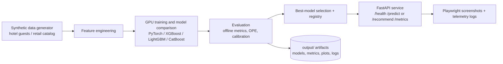

# Machine Learning Portfolio: Customer Analytics, Recommenders and Decisioning

## Purpose

A monorepo of nine applied machine-learning projects for **hospitality and retail**. Each one follows the same production-minded pattern: generate or load data, train and compare several models on GPU, evaluate with domain-appropriate metrics, persist artifacts, and expose a FastAPI service with logged metrics and Playwright-captured screenshots.

| Theme | Projects |
|---|---|
| Customer value and risk | CLTV scoring, survival analysis (rebooking), imbalanced classification |
| Customer structure | Customer segmentation, clustering |
| Decisioning | Next-best-action with contextual bandits and with causal uplift |
| Retail discovery and recommendation | Item-based CF, two-tower retrieval, three cold-start approaches, discovery re-ranking with bandits |

**Intended users:** data scientists and ML engineers who want runnable, documented reference implementations with verifiable evaluation outputs.

## High-level project metrics

### Codebase summary

| Item | Value | Source |
|---|---|---|
| Top-level project folders | 9 (13 runnable sub-projects, 5 of them under `recommenders/`) | directory listing |
| Tracked files | about 880 (before the READMEs added in this change) | `git ls-files` at audit time |
| Languages / frameworks | Python 3.12, PyTorch, XGBoost / LightGBM / CatBoost, scikit-learn, FAISS, EconML, lifelines / scikit-survival, FastAPI + Pydantic, Playwright; Node.js (`pptxgenjs`) for two slide decks | per-project requirements |
| Test functions (`def test_`, counted statically) | 68 across 8 sub-projects; 4 sub-projects have none (CLTV, clustering, Class_Inbalance, cold-start_quantization_VAE) and ItemBasedCF uses a 35-assertion verification script instead | per-project READMEs |
| Hardware of committed runs | NVIDIA RTX 3090 (the Next-Best-Action uplift project is CPU-only) | per-project logs |

### Model and operational KPIs (verified in committed outputs)

| Project | Metric | Value | Source |
|---|---|---|---|
| Discovery re-ranking | Cold-start score gap at equal relevance | -38% | `Discovery_Re-ranking/retail-discovery-bandit/output/metrics/cold_start_bottleneck.json` |
| Discovery re-ranking | LinUCB + MMR reward vs pure ranker; cold-start impressions | 96.6% retained; 1.74% vs 0.14% | `.../output/metrics/stage4_policy_summary.json` |
| Discovery re-ranking | OPE error vs ground truth (IPS/SNIPS/DR) | 0.6-1.6% | `.../output/metrics/ope_results.json` |
| Discovery re-ranking | End-to-end latency p50 / p99 | 18.7 / 26.2 ms | `.../output/metrics/latency_by_stage_policy.csv` |
| CLTV | Normalized Gini, best / top-3 ensemble | 0.749 / 0.757 | `CLTV/hospitality_cltv/output/logs/metrics_summary.json` |
| CLTV | R2, ensemble | 0.412 | same |
| Survival modeling | Uno C / IBS of selected `xgboost_aft` | 0.671 / 0.198 | `Survival_modeling/hospitality_survival_mlops/output/training_logs/metrics_summary.json` |
| Class imbalance (0.54% positives) | CatBoost test PR-AUC / ROC-AUC / F2 | 0.625 / 0.937 / 0.588 | `Class_Inbalance/outputs/metrics_summary.csv` |
| Customer segmentation | DEC autoencoder silhouette / stability ARI | 0.343 / 0.9999 | `customer_segmentation/output/model_comparisons/model_benchmark_summary.csv` |
| Clustering | K-Means (K=5) silhouette / ARI vs truth | 0.376 / 0.994 | `clustering/hospitality_clustering/output/logs/metrics_summary.json` |
| NBA, contextual bandits | Best policy LinUCB-Disjoint: DR vs true value | 609.9 vs 617.3 (oracle 629.1) | `Next-Best-Action_ContextualBandits/output/logs/ope_evaluation_audit.json` |
| NBA, causal uplift | SNIPS net margin per customer, guardrailed vs legacy CRM | 5.76 vs 4.71 | `Next-Best-Action_NBA/outputs/saved_models/model_manifest.json` |
| ItemBasedCF | NDCG@10 / Recall@10 (validation) | 0.273 / 0.375 | `recommenders/ItemBasedCF/output/artifacts/` |
| Two-Tower | Test Recall@50; API server p99 | 0.127; 23 ms | `recommenders/Two-Tower_model/outputs/metrics/` |
| Cold-start router | Hybrid Recall@10, cold-user / cold-item | 0.179 / 0.213 | `recommenders/cold-start/outputs/metrics/` |
| Cold-start semantic IDs | Hybrid item-cold Recall@10; RQ-VAE collision rate | 0.587; 0.002 | `recommenders/cold-start_quantization_VAE/outputs/logs/` |
| Cold-start representation learning | Ensemble warm recall@20; item-cold recall@20 (best learner) | 0.166; 0.123 | `.../retail-coldstart-replearning/outputs/metrics/offline_evaluation.json` |

Each value comes from a committed output file or an existing project README; several are from different synthetic datasets and are **not comparable across projects**.

## Subfolders at This Level

| Subfolder | Core purpose | High-level metrics tracked |
|---|---|---|
| [`CLTV/`](CLTV/README.md) | 12-month guest lifetime-value scoring: 7 model paradigms plus a top-3 ensemble, FastAPI serving | Normalized Gini, R2, RMSE, top-10% revenue capture, calibration ratio, VIP/High/Medium tier cutoffs |
| [`Survival_modeling/`](Survival_modeling/README.md) | Rebooking-time survival analysis on right-censored data: 10 models compared, best served with a next-best-action rule | Harrell / Uno C-index, integrated Brier score, time-dependent AUC at 30/90/180/365 days |
| [`Class_Inbalance/`](Class_Inbalance/README.md) | GPU gradient-boosting pipeline for a 0.5%-positive classification problem with tuned F2 threshold | PR-AUC, ROC-AUC, F2, precision/recall, MCC |
| [`customer_segmentation/`](customer_segmentation/README.md) *(existing README)* | 6 clustering models on synthetic hotel guests with composite-rank model selection and a serving API | Silhouette, Davies-Bouldin, Calinski-Harabasz, stability ARI, segment business KPIs |
| [`clustering/`](clustering/README.md) | Compact clustering pipeline: K-Means, GMM, Agglomerative, DBSCAN, DEC, VAE+GMM with persona naming and an API | Silhouette, Calinski-Harabasz, Davies-Bouldin, ARI vs ground truth |
| [`Next-Best-Action_ContextualBandits/`](Next-Best-Action_ContextualBandits/README.md) *(existing README)* | Hospitality next-best-action: 10 contextual-bandit policies validated by off-policy evaluation and online replay | DR/IPS/SNIPS vs true policy value, effective sample size, fit time |
| [`Next-Best-Action_NBA/`](Next-Best-Action_NBA/README.md) *(existing README)* | Retail next-best-action with an EconML DR-learner, margin-aware guardrailed policy and SNIPS evaluation | AUUC, decile Spearman, SNIPS net margin, unsubscribe rate vs cap, serving p99 target |
| [`recommenders/`](recommenders/README.md) | Five retail recommender sub-projects (item CF, two-tower, three cold-start approaches) | Recall@K, NDCG@K, coverage, ANN recall, API latency |
| [`Discovery_Re-ranking/`](Discovery_Re-ranking/README.md) | Discovery re-ranking with LinUCB exploration, MMR diversity and propensity logging, plus off-policy evaluation | Cold-start share and conversion, discovery share, coverage, ILD, OPE error, latency |

## System architecture and data flow

The projects are independent; they share one design pattern rather than code.



| Layer | Projects |
|---|---|
| Value and risk prediction | CLTV, Survival_modeling, Class_Inbalance |
| Structure discovery | customer_segmentation, clustering |
| Decisioning under uncertainty | Next-Best-Action_ContextualBandits, Next-Best-Action_NBA |
| Retrieval, ranking, cold start, discovery | recommenders, Discovery_Re-ranking |

## Prerequisites and environment setup

| Item | Requirement |
|---|---|
| Python | 3.12 (committed bytecode and logs are 3.12) |
| GPU | NVIDIA GPU with CUDA recommended; committed runs used an RTX 3090 (torch 2.15.0+cu132 in the Discovery project). `Next-Best-Action_NBA` needs no GPU; several projects fall back to CPU |
| Node.js | Only for the two slide-deck builders (`Discovery_Re-ranking/presentation`, `Next-Best-Action_ContextualBandits/NBA_ContextBandits_Presentation`) |
| Browser tests | `python -m playwright install chromium` for screenshot and visual tests |

Each project has its own `requirements.txt` (the Discovery project also has `environment.yml`). Create one environment per project:

```bash
cd <project-folder>
python -m venv .venv && source .venv/bin/activate        # or: conda create -n <name> python=3.12
pip install -r requirements.txt                           # install the CUDA build of torch for your toolkit first
```

Most requirement files are unpinned or lower-bounded only.

## Configuration and environment variables

No `.env` or `.env.example` exists in the repository; configuration lives in each project's `config.yaml`, `config.py` or CLI flags. Environment variables found by the audits:

| Variable | Project | Default | Required | Purpose |
|---|---|---|---|---|
| `COLDSTART_REDIS_URL` | `recommenders/cold-start` | unset (in-process LRU cache) | No | Optional Redis cache for the API |
| `PIPELINE_QUICK` | `recommenders/cold-start_quantization_VAE` | unset | No | Quick pipeline mode (same as `--quick`) |
| `APPLY_THEME`, `NODE_PATH` | `Discovery_Re-ranking/presentation` | unset | Only to rebuild the deck | Path to the pptx theme helper and to `node_modules` |

## Usage and execution

Commands below are documented entry points (see each project's README for flags and artifact locations).

| Project | Train / run pipeline | Serve | Test |
|---|---|---|---|
| `Discovery_Re-ranking/retail-discovery-bandit` | `python scripts/train_and_simulate.py` then `python scripts/generate_artifacts.py` | `uvicorn src.api.main:app` | `python -m pytest tests -q` |
| `CLTV/hospitality_cltv` | `python run_pipeline.py` | `uvicorn src.api:app` | none |
| `Survival_modeling/hospitality_survival_mlops` | `python -m src.train_pipeline` | `uvicorn src.api:app` | `pytest tests` |
| `Class_Inbalance` | `python imbalance_gpu_pipeline.py` | n/a | none |
| `customer_segmentation` | `python -m src.train_pipeline` | `uvicorn src.api:app` | `pytest tests` |
| `clustering/hospitality_clustering` | `python run_pipeline.py` | `uvicorn api:app` | none |
| `Next-Best-Action_ContextualBandits` | `python run_pipeline.py` | `uvicorn src.api:app` | `pytest tests` |
| `Next-Best-Action_NBA` | `python run_pipeline.py` | `uvicorn nba.service:app` | `pytest tests` |
| `recommenders/ItemBasedCF` | `python train_pipeline.py` | `uvicorn api:app` | `python verify_and_screenshot_api.py` |
| `recommenders/Two-Tower_model` | `python -m src.run_pipeline` | `uvicorn api.main:app` | `pytest` |
| `recommenders/cold-start` | `python run_pipeline.py` | `uvicorn src.serving.app:app` | `pytest tests/test_api.py` |
| `recommenders/cold-start_quantization_VAE` | `python run_pipeline.py` | `uvicorn src.api.app:app` | none |
| `recommenders/cold-start-representaiton_learning/retail-coldstart-replearning` | `python run_pipeline.py` | `uvicorn src.serving.app:app` | `pytest tests` |

Run each command from inside its project folder. Metric outputs land in the project's `output/` (or `outputs/`) directory; most API tests need the pipeline to have been run first.

## Cross-repository audit notes

| Finding | Where |
|---|---|
| No `.env.example` anywhere; no secrets found | whole repo |
| Requirements are unpinned or lower-bounded only | all projects |
| `__pycache__` / `.pyc` files present on disk in many projects; several projects have no `.gitignore` (clustering, Class_Inbalance, ItemBasedCF, Two-Tower, Next-Best-Action_NBA) | see per-project READMEs |
| No automated tests for CLTV, clustering, Class_Inbalance, cold-start_quantization_VAE; other suites are API smoke tests that need pre-built artifacts | per-project READMEs |
| Several committed logs and metrics came from notebook runs rather than the pipeline scripts | Next-Best-Action_ContextualBandits, cold-start-representaiton_learning |
| Unused or dead config keys (`api_days`, `api.*`, `n_sessions_total` branch) | Survival_modeling, CLTV, cold-start-representaiton_learning, Next-Best-Action_NBA |
| Existing READMEs that differ from committed outputs or scripts (left untouched): customer_segmentation lists `api_server.log` and `api_screenshots/` as committed outputs; Next-Best-Action_NBA shows `--n 100000` while the script default is 30000; cold-start_quantization_VAE states 800 requests per regime while the metrics CSV shows 500 for two regimes | those READMEs |
