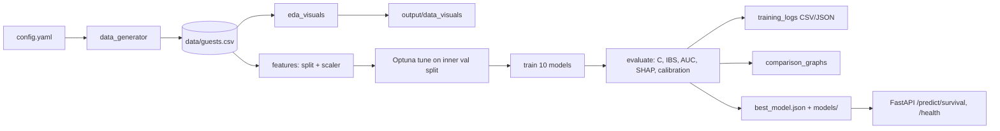

# Hospitality Guest Survival MLOps

## 1. Purpose
Time-to-rebooking (churn) modelling for hotel loyalty guests. The project generates a synthetic, right-censored guest dataset, tunes and compares 10 survival models (Kaplan-Meier, Nelson-Aalen, CoxPH, Weibull AFT, LogNormal AFT, Random Survival Forest, XGBoost-Cox, XGBoost-AFT, DeepSurv, DeepHit), picks the best deployable one, and serves it through a FastAPI endpoint. The endpoint returns survival and rebooking probabilities at 30/60/90/180/365 days, a risk percentile, a median survival time, and a rule-based next-best marketing action.
Users: data scientists comparing survival methods, and CRM/loyalty teams consuming churn-risk scores.

## 2. High-level metrics
**Codebase summary**
| Item | Value |
|---|---|
| Language / frameworks | Python 3.12 (per `.pyc` files); lifelines, scikit-survival, XGBoost, PyTorch, Optuna, SHAP, FastAPI, pytest, Playwright |
| Source modules | 13 `.py` files in `src/` (12 modules plus `__init__.py`); 2 in `tests/` |
| Test files / cases | 1 test file (`tests/test_api.py`) with 3 `def test_` cases; plus `tests/capture_api_screenshots.py` (not a test) |
| Entry points | `python -m src.train_pipeline`, `python -m src.data_generator`, `uvicorn src.api:app`, `run_all.sh` / `run_all.ps1` |

**Verified (observed)** - hold-out test set of 3000 guests (train 12000), device cuda (RTX 3090), 316.3 s total. Source: `output/training_logs/metrics_summary.json`, `model_comparison.csv`, `output/models/best_model.json`.
| Metric | Purpose | Observed value | Source |
|---|---|---|---|
| Best model (by Uno C, IBS < 0.25) | Serving model | `xgboost_aft` | `best_model.json` |
| Uno C-index, xgboost_aft | Ranking quality (IPCW) | 0.6712 | `model_comparison.csv` |
| Harrell C-index, xgboost_aft | Ranking quality | 0.6898 (best of all models) | `model_comparison.csv` |
| Integrated Brier Score, xgboost_aft | Calibration plus discrimination (lower is better) | 0.1983 | `model_comparison.csv` |
| Lowest IBS | Best calibrated | 0.1794 (random_survival_forest) | `model_comparison.csv` |
| Mean time-dependent AUC, best | Time-specific discrimination | 0.7499 (random_survival_forest); xgboost_aft 0.7474 | `model_comparison.csv` |
| Baselines (KM, Nelson-Aalen) | Sanity floor | C = 0.5, IBS ~0.2139 | `model_comparison.csv` |
| CoxPH Harrell C | Classical reference | 0.6735 | `model_comparison.csv` |
| Censoring rate | Dataset check | 0.30 | `metrics_summary.json` |
| Tuning val C-index | Optuna objective | 0.6737 (coxph) to 0.6845 (xgb_aft) | `metrics_summary.json` |

**Tracked / target KPIs** (computed each run, `Logged at runtime`)
| Metric | Definition | Where logged |
|---|---|---|
| Harrell C, Uno C | Concordance, plain and IPCW | `model_comparison.csv`, `pipeline.log` |
| IBS / 1-IBS | Integrated Brier score over a 12-point grid, 30-365 d | `model_comparison.csv` |
| auc_30d/90d/180d/365d, mean_time_auc | `cumulative_dynamic_auc` with 1 - S(t\|x) | `model_comparison.csv` |
| train_seconds | Fit time per model | `model_comparison.csv` |
| CoxPH PH-test violations | p < 0.01 | `coxph_proportional_hazards_test.csv` |

No numeric KPI target thresholds are defined, other than the selection gate IBS < 0.25.

## 3. Subfolders at This Level
| Subfolder | Purpose | High-level metrics |
|---|---|---|
| `config/` | `config.yaml`: seed, paths, data size, Optuna trials, model hyper-parameters, API host/port | 1 file, 83 lines |
| `data/` | `guests.csv`, the generated synthetic dataset (asset) | Configured 15000 rows, 30% censored |
| `output/` | Generated artifacts: `models/`, `training_logs/`, `data_visuals/` (6 PNG), `comparison_graphs/` (7 PNG), `api_screenshots/` (6 PNG + JSON), `notebook/` (uncommitted notebook-run copy of data, visuals and logs) | 10 models trained; see the table above |
| [`src/`](src/README.md) | Pipeline, models, evaluation, API | 13 `.py` files, 10 model classes, 2 endpoints |
| `tests/` | `test_api.py` (API smoke tests) and `capture_api_screenshots.py` (Playwright Swagger screenshots) | 1 test file, 3 test cases |

## 4. Architecture & data flow

Selection rule: non-baseline models with IBS < 0.25, sorted by Uno C descending, then IBS ascending.

## 5. Prerequisites & setup
- Python 3.12 (the committed bytecode is cp312). A CUDA GPU is optional: `gpu.use_cuda: true` falls back to CPU. The observed run used an RTX 3090.
- Dependencies are in `requirements.txt` (numpy>=2.0, pandas>=2.2,<3, scikit-survival>=0.23, lifelines>=0.30, xgboost>=2.1, torch>=2.3, optuna>=3.6, shap, fastapi, playwright, pytest, and others).
- `run_all.sh` documents a CUDA torch build: `pip install torch --index-url https://download.pytorch.org/whl/cu124`.
```text
pip install -r requirements.txt
python -m playwright install chromium   # only for screenshots
```

## 6. Configuration (`config/config.yaml`)
| Key | Default | Required | Description |
|---|---|---|---|
| `seed` | 42 | yes | Global seed |
| `paths.*` | `data/guests.csv`, `output/{models,data_visuals,training_logs,comparison_graphs,api_screenshots}` | yes | Relative to project root |
| `data.n_samples` / `target_censoring` / `max_follow_up_days` | 15000 / 0.30 / 900 | yes | Synthetic data |
| `split.test_size` | 0.20 | yes | Hold-out fraction |
| `time_horizons.*` | `auc_days` [30,90,180,365]; `deephit_bins` [30,60,90,180,365]; grid 30-365 d, 12 points; `api_days` [30,60,90,180,365] | yes | Evaluation horizons |
| `gpu.use_cuda` | true | no | CPU fallback if CUDA is unavailable |
| `optuna.enabled` / `n_trials.*` | true / coxph 12, rsf 6, xgb_cox 15, xgb_aft 15, deepsurv 8, deephit 6 | yes | Tuning budget |
| `models.<name>.*` | see file | yes | Default hyper-parameters (overridden by tuned values) |
| `api.host` / `api.port` | 127.0.0.1 / 8000 | no | Used only by `capture_api_screenshots.py` |
No environment variables are read.

## 7. Usage
```text
# full flow (install, train, API tests, screenshots)
bash run_all.sh            # or: powershell run_all.ps1 ; extra args go to the pipeline (e.g. --quick)
python -m src.train_pipeline [--config PATH] [--quick] [--n N]
uvicorn src.api:app --host 127.0.0.1 --port 8000    # then /docs, /health, POST /predict/survival
pytest -q tests/test_api.py
python tests/capture_api_screenshots.py
```
Artifacts: `output/models/` (incl. `best_model.json`, `preprocessor.pkl`), `output/training_logs/` (`metrics_summary.json`, `model_comparison.csv`, `optuna_*.csv`, `pipeline.log`), `output/comparison_graphs/`, `output/data_visuals/`.

## 8. Audit notes
- `src/api.py` hard-codes `HORIZONS`; `time_horizons.api_days` in the config is unused. The `RSF` default `n_estimators` in the pipeline is overridden by Optuna's `n_estimators=100`, then re-set to the config default 200 in the final run.
- The tuned `xgb_aft` has the best C-index but a noticeably worse IBS (0.1983) than RSF (0.1794) and xgboost_cox (0.1804); selection is by Uno C only, so calibration is traded away.
- Tests cover the API only (3 cases, skipped when `best_model.json` is missing); no unit tests for models, features or evaluation.
- `random_survival_forest.pkl` is gitignored (the comment says 7+ GB); the API therefore cannot serve RSF from a fresh clone. `uvicorn.log` and `full_run_stdout.txt` are also gitignored.
- `__pycache__/` and `.pytest_cache/` exist on disk; they are gitignored. `output/pipeline.log` and `output/notebook/` carry uncommitted changes.
