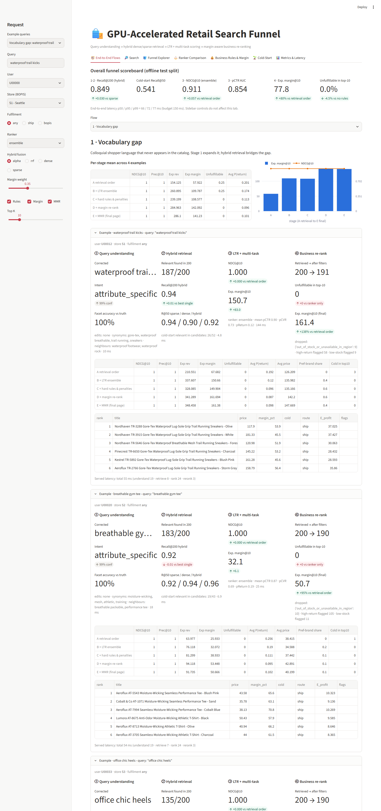
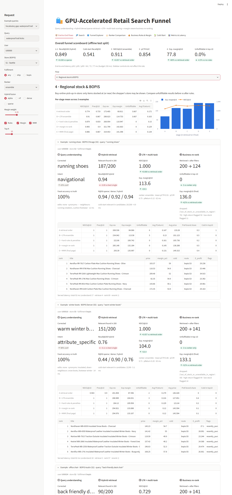
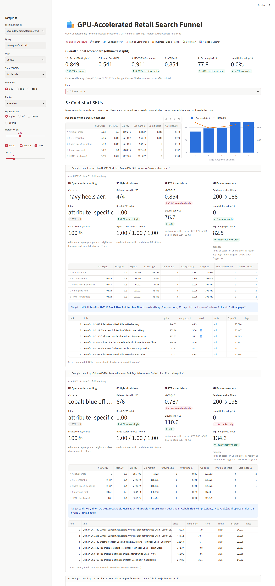
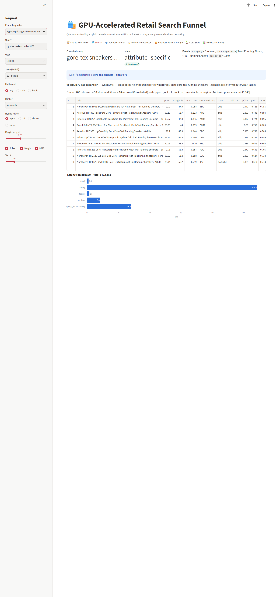
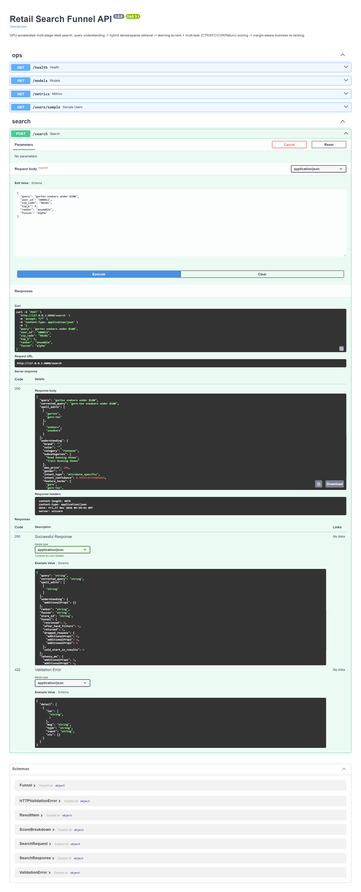

# Retail ML Search Funnel

GPU-accelerated multi-stage retail search & ranking that optimises **expected revenue and gross margin**, not CTR.
Everything here is generated, trained, served and screenshotted from this repo (synthetic data; see *Limitations*).

```
query -> 1 Query understanding -> 2 Hybrid retrieval (N=200) -> 3 LTR + multi-task scoring -> 4 Business re-rank -> top-K
         spell, NER/intent,       BM25F + char n-gram + learned   8 LTR models + ensemble;     hard filters, penalties,
         synonym + embedding      expansion  +  bge-small          pCTR/pATC/pCVR/pReturn       margin optimiser, MMR
         expansion                multimodal vectors in FAISS
```

## Challenges addressed
| Reality | Solution |
|---|---|
| Vocabulary gap ("waterproof trail kicks" -> "Gore-Tex trail running sneakers") | SymSpell spell-fix on catalog vocab, curated synonym graph, embedding-neighbour terms, click-learned (SPLADE-style) sparse expansion, dense bge retrieval |
| Multi-objective | `E[profit] = pCTR * pATC|click * pCVR|cart * margin * (1 - pReturn)`; blended with relevance by the margin optimiser (a relevance floor stops irrelevant-but-profitable items) |
| Hard rules / regional stock | OOS and region/BOPIS filters, brand allow/deny, hard price caps (also parsed from "under $100"), soft penalties for high return rate, low stock, recently bought durables |
| Long tail / cold start | 15% of SKUs have zero history; they are indexed on text + synthetic image + tabular content fused into one vector space, and ranked from content/brand/price features |

## Quick start
```bash
pip install -r requirements.txt && python -m playwright install chromium
python scripts/run_pipeline.py --regen     # data -> index -> train -> evaluate (~2.5 min on an RTX 3090)
python scripts/run_flows.py                 # per-stage metrics for every flow example (refreshes README block)
pytest -q tests/                            # 22 tests
uvicorn src.api.main:app --port 8000        # Swagger at /docs
streamlit run src/ui/app.py                 # UI
python scripts/capture_screenshots.py       # Playwright screenshots -> outputs/screenshots
```
`--small` gives a ~45 s smoke run (it overwrites `data/`; use `--regen` afterwards for the full run).

## Layout
`src/data_gen` generator, `src/query_understanding`, `src/retrieval`, `src/ranking` (features, 8 LTR models, multi-task heads), `src/reranking`, `src/evaluation`, `src/api`, `src/ui`, `src/engine.py` (stages 1-2), `src/search_service.py` (full funnel), `configs/config.yaml`, `outputs/{models,metrics,logs,screenshots}`.

## Data (12,000 SKUs, 2,000 users, 1M impressions)
19 product types over 7 categories, 18 brands in 3 tiers, 1,779 cold-start SKUs, 5 stores + online warehouse with per-SKU stock, 3,000 colloquial/typo/navigational/formal queries, and a 100k-session Impression -> Click -> Cart -> Purchase -> Return log (25.5% CTR; 85.7k purchases; 14.1k returns). About 8% of SKUs have *misleading titles* (they claim a feature they lack): they attract clicks but get returned more. Ground truth comes from a latent model kept in `catalog_latent.parquet`, used only by evaluation.

## Results (test split, synthetic data)
**Retrieval** (recall normalised by min(|relevant|, N); relevant = grade-3 and purchasable online; latency includes query understanding + encode)

| Retriever | R@50 | R@200 | Cold-start R@50 | Cold-start R@200 | p95 ms |
|---|---|---|---|---|---|
| Sparse (BM25F + char + learned) | 0.711 | 0.819 | 0.498 | 0.742 | 13.9 |
| Dense (bge-small + multimodal) | 0.751 | 0.848 | 0.522 | 0.769 | 14.2 |
| Hybrid RRF | 0.754 | 0.851 | 0.533 | 0.771 | 13.9 |
| Hybrid alpha=0.6 (tuned on val) | **0.764** | 0.849 | **0.541** | 0.767 | 14.4 |

**Ranking** (k=10; revenue/margin = expected value per page, position-discounted, from latent truth)

| Model | NDCG@10 (rel) | NDCG@10 (eng) | Exp. revenue | Exp. margin |
|---|---|---|---|---|
| Retrieval order (no LTR) | 0.854 | 0.689 | 118.0 | 43.2 |
| XGB pointwise (GPU) | 0.916 | 0.883 | 173.2 | 67.8 |
| LGBM pointwise | 0.894 | 0.880 | 170.8 | 66.3 |
| XGB pairwise (GPU) | 0.909 | 0.882 | 172.1 | 66.4 |
| LGBM LambdaMART | 0.897 | 0.879 | 168.7 | 65.0 |
| CatBoost YetiRank (GPU) | 0.895 | 0.873 | 165.0 | 62.8 |
| XGB listwise rank:ndcg (GPU) | 0.893 | 0.870 | 167.2 | 64.0 |
| ListNet (torch) | **0.927** | 0.881 | **180.2** | **69.1** |
| DCNv2 (torch) | 0.923 | 0.870 | 171.3 | 64.8 |
| **Ensemble** (default; top-4 by val NDCG) | 0.911 | **0.884** | 172.2 | 66.6 |

Differences between the learned models are small (single seed, 300 lists), so treat their ordering as noise; the gap to retrieval order is real.
Multi-task heads (test): pCTR AUC 0.854, pATC|click AUC 0.758, pCVR|cart AUC 0.668, pReturn correlation with latent 0.71.

**Re-ranking ablation** (ensemble ranker)

| Stage | NDCG@10 | Exp. revenue | Exp. margin | OOS in top-10 | Avg return prob |
|---|---|---|---|---|---|
| 1 ranker only | 0.911 | 172.2 | 66.6 | 4.5% | 0.155 |
| 2 + hard filters & penalties | 0.906 | 165.8 | 66.1 | 0% | 0.123 |
| 3 + margin-aware re-rank | 0.903 | 186.1 | 78.2 | 0% | 0.118 |
| 4 + MMR diversity (full funnel) | 0.900 | 185.3 | 77.8 | 0% | see `outputs/metrics/rerank_ablation.csv` |

Margin optimisation gives about +17% expected margin for about 0.8 pt NDCG; hard rules cost a little relevance but remove every unfulfillable result.

**Latency** (200 test queries incl. typos, ensemble, RTX 3090, faiss-cpu HNSW), ms

| Stage | p50 | p95 | p99 |
|---|---|---|---|
| Query understanding (incl. GPU encode) | 19.0 | 22.1 | 24.1 |
| Retrieval (sparse + dense + fuse) | 6.8 | 7.8 | 8.5 |
| Features | 1.0 | 1.2 | 1.3 |
| Ranking (4-model ensemble + 4 heads) | 37.5 | 41.5 | 42.9 |
| Re-rank | 1.5 | 3.4 | 3.6 |
| **Total** | **65.6** | **71.8** | **77.1** |

Within the 150 ms budget. The spec's "<10 ms" for query understanding holds only for the non-neural part (spell/NER/expansion take about 1 ms); the stage as a whole is about 19 ms because it includes the query embedding, so the configured budget is 30 ms.

<!-- FLOWS:START -->
### End-to-end flows (per-stage metrics against simulator ground truth)

Each example runs the real funnel. Stage variants share the same 200 hybrid candidates: **A** retrieval order, **B** + LTR ensemble, **C** + hard rules & penalties, **D** + margin re-rank, **E** + MMR (final page). Metrics are @10; revenue/margin are expected values per page from the latent model.

#### 1 · Vocabulary gap

Colloquial shopper language that never appears in the catalog. Stage 1 expands it; hybrid retrieval bridges the gap.

| Example | Stage 1: corrected / intent / facet acc. | Stage 2: relevant in 200 (R@200 sparse/dense/hybrid) | NDCG A→B→E | Margin A→E | Unfulfillable A→E | ms total |
|---|---|---|---|---|---|---|
| waterproof trail kicks | `waterproof trail kicks` / attribute_specific (99%) / 100% | 187/200 (0.93/0.93/0.94) | 1.000→1.000→1.000 | 67.7→161.4 | 0→0 | 65 |
| breathable gym tee | `breathable gym tee` / attribute_specific (99%) / 100% | 183/200 (0.92/0.91/0.92) | 1.000→1.000→1.000 | 25.9→50.7 | 0→0 | 63 |
| office chic heels | `office chic heels` / attribute_specific (97%) / 100% | 135/200 (0.93/0.52/0.68) | 1.000→1.000→1.000 | 49.7→124.8 | 1→0 | 61 |
| warm winter puffer | `warm winter puffer` / attribute_specific (100%) / 100% | 167/200 (0.92/0.71/0.83) | 1.000→1.000→1.000 | 88.4→228.1 | 0→0 | 61 |

Mean over this flow's examples:

| Stage | NDCG@10 | Precision@10 | Exp. revenue | Exp. margin | Unfulfillable | Avg return prob |
|---|---|---|---|---|---|---|
| A retrieval order | 1.000 | 1.000 | 154.1 | 57.9 | 0.2 | 0.201 |
| B + LTR ensemble | 1.000 | 1.000 | 260.9 | 109.8 | 0.2 | 0.174 |
| C + hard rules & penalties | 1.000 | 1.000 | 239.2 | 108.6 | 0.0 | 0.113 |
| D + margin re-rank | 1.000 | 1.000 | 285.0 | 142.1 | 0.0 | 0.096 |
| E + MMR (final page) | 1.000 | 1.000 | 286.1 | 141.2 | 0.0 | 0.101 |

#### 2 · Typos + price constraint

Misspellings are fixed against catalog vocabulary and 'under $N' becomes a hard price filter.

| Example | Stage 1: corrected / intent / facet acc. | Stage 2: relevant in 200 (R@200 sparse/dense/hybrid) | NDCG A→B→E | Margin A→E | Unfulfillable A→E | ms total |
|---|---|---|---|---|---|---|
| gortex snekers under $100 | `gore-tex sneakers under $100` / attribute_specific (100%) / 100% | 29/59 (0.49/0.34/0.49) | 0.571→0.816→0.919 | 30.7→70.5 | 0→0 | 57 |
| breathble gym tee under $30 | `breathable gym tee under $30` / attribute_specific (100%) / 100% | 55/115 (0.45/0.43/0.48) | 0.656→0.964→1.000 | 9.2→16.5 | 0→0 | 62 |
| warm pufer jaket below $200 | `warm puffer jacket below $200` / attribute_specific (100%) / 100% | 85/199 (0.46/0.39/0.43) | 0.894→0.671→0.724 | 70.7→121.3 | 0→0 | 63 |
| legings with pockets under $60 | `leggings with pockets under $60` / attribute_specific (100%) / 100% | 110/200 (0.52/0.54/0.55) | 0.776→1.000→1.000 | 21.4→43.3 | 0→0 | 57 |

Mean over this flow's examples:

| Stage | NDCG@10 | Precision@10 | Exp. revenue | Exp. margin | Unfulfillable | Avg return prob |
|---|---|---|---|---|---|---|
| A retrieval order | 0.724 | 0.475 | 94.0 | 33.0 | 0.0 | 0.218 |
| B + LTR ensemble | 0.863 | 0.825 | 145.6 | 60.9 | 0.8 | 0.192 |
| C + hard rules & penalties | 0.912 | 0.925 | 132.8 | 57.4 | 0.0 | 0.154 |
| D + margin re-rank | 0.912 | 0.900 | 137.4 | 61.9 | 0.0 | 0.148 |
| E + MMR (final page) | 0.911 | 0.900 | 138.0 | 62.9 | 0.0 | 0.146 |

#### 3 · Navigational (brand) intent

Brand-led queries: the intent classifier flags navigational intent, brand features dominate, and the brand diversity cap is lifted.

| Example | Stage 1: corrected / intent / facet acc. | Stage 2: relevant in 200 (R@200 sparse/dense/hybrid) | NDCG A→B→E | Margin A→E | Unfulfillable A→E | ms total |
|---|---|---|---|---|---|---|
| aeroflux running shoes | `aeroflux running shoes` / navigational (63%) / 100% | 143/143 (1.00/0.99/1.00) | 1.000→1.000→1.000 | 69.7→126.5 | 2→0 | 56 |
| terrapeak jackets | `terrapeak jackets` / attribute_specific (67%) / 100% | 188/200 (0.92/0.94/0.94) | 1.000→1.000→1.000 | 79.4→279.9 | 0→0 | 59 |
| hearthly bedding | `hearthly bedding` / attribute_specific (94%) / 100% | 78/78 (1.00/1.00/1.00) | 1.000→1.000→1.000 | 60.3→114.3 | 0→0 | 54 |
| voltra headphones | `voltra headphones` / navigational (60%) / 100% | 64/64 (1.00/1.00/1.00) | 1.000→1.000→1.000 | 73.3→143.1 | 0→0 | 56 |

Mean over this flow's examples:

| Stage | NDCG@10 | Precision@10 | Exp. revenue | Exp. margin | Unfulfillable | Avg return prob |
|---|---|---|---|---|---|---|
| A retrieval order | 1.000 | 1.000 | 187.1 | 70.7 | 0.5 | 0.112 |
| B + LTR ensemble | 1.000 | 1.000 | 281.1 | 117.7 | 0.5 | 0.097 |
| C + hard rules & penalties | 1.000 | 1.000 | 279.8 | 119.0 | 0.0 | 0.086 |
| D + margin re-rank | 1.000 | 1.000 | 386.4 | 167.3 | 0.0 | 0.080 |
| E + MMR (final page) | 1.000 | 1.000 | 387.3 | 166.0 | 0.0 | 0.082 |

#### 4 · Regional stock & BOPIS

Buy-online-pick-up-in-store: only items stocked at (or near) the shopper's store may be shown. Compare unfulfillable results before vs after rules.

| Example | Stage 1: corrected / intent / facet acc. | Stage 2: relevant in 200 (R@200 sparse/dense/hybrid) | NDCG A→B→E | Margin A→E | Unfulfillable A→E | ms total |
|---|---|---|---|---|---|---|
| running shoes · BOPIS Chicago (S3) | `running shoes` / navigational (43%) / 100% | 187/200 (0.93/0.94/0.94) | 1.000→1.000→1.000 | 84.1→136.0 | 6→0 | 56 |
| winter boots · BOPIS Denver (S5) | `warm winter boots` / attribute_specific (98%) / 100% | 151/200 (0.66/0.87/0.76) | 0.943→1.000→1.000 | 87.6→133.1 | 2→0 | 60 |
| office chair · BOPIS Austin (S2) | `back friendly desk chair` / attribute_specific (99%) / 100% | 90/200 (0.44/0.51/0.45) | 0.378→0.729→0.659 | 34.8→155.1 | 3→0 | 61 |

Mean over this flow's examples:

| Stage | NDCG@10 | Precision@10 | Exp. revenue | Exp. margin | Unfulfillable | Avg return prob |
|---|---|---|---|---|---|---|
| A retrieval order | 0.774 | 0.733 | 173.4 | 68.8 | 3.7 | 0.172 |
| B + LTR ensemble | 0.910 | 0.867 | 288.6 | 114.8 | 3.7 | 0.163 |
| C + hard rules & penalties | 0.879 | 0.833 | 269.0 | 110.9 | 0.0 | 0.150 |
| D + margin re-rank | 0.905 | 0.900 | 321.8 | 142.7 | 0.0 | 0.129 |
| E + MMR (final page) | 0.886 | 0.867 | 319.5 | 141.4 | 0.0 | 0.134 |

#### 5 · Cold-start SKUs

Brand-new drops with zero interaction history are retrieved from text+image+tabular content embeddings and still reach the page.

| Example | Stage 1: corrected / intent / facet acc. | Stage 2: relevant in 200 (R@200 sparse/dense/hybrid) | NDCG A→B→E | Margin A→E | Unfulfillable A→E | ms total |
|---|---|---|---|---|---|---|
| new drop: Aeroflux H-9211 Block Heel Pointed Toe Stiletto  | `navy heels aeroflux` / attribute_specific (85%) / 100% | 4/4 (1.00/1.00/1.00) | 1.000→0.854→0.928 | 63.1→82.5 | 0→0 | 64 |
| new drop: Quillon OC-2081 Breathable Mesh Back Adjustable  | `cobalt blue office chairs quillon` / attribute_specific (93%) / 100% | 6/6 (1.00/1.00/1.00) | 1.000→0.787→0.810 | 72.2→134.3 | 1→0 | 57 |
| new drop: TerraPeak RJ-5763 Pit Zips Waterproof Rain Shell | `black rain jackets terrapeak` / attribute_specific (88%) / 100% | 4/4 (1.00/1.00/1.00) | 0.907→0.767→0.923 | 116.2→148.2 | 0→0 | 59 |

| Cold SKU | impressions | rank sparse | rank dense | rank hybrid | rank in final page |
|---|---|---|---|---|---|
| Aeroflux H-9211 Block Heel Pointed Toe Stiletto Heels - Navy | 0 | 2 | 2 | 3 | 2 |
| Quillon OC-2081 Breathable Mesh Back Adjustable Armrests Mes | 0 | 6 | 6 | 6 | 8 |
| TerraPeak RJ-5763 Pit Zips Waterproof Rain Shell - Black | 0 | 1 | 2 | 1 | 1 |

Mean over this flow's examples:

| Stage | NDCG@10 | Precision@10 | Exp. revenue | Exp. margin | Unfulfillable | Avg return prob |
|---|---|---|---|---|---|---|
| A retrieval order | 0.969 | 0.500 | 189.2 | 83.8 | 0.3 | 0.143 |
| B + LTR ensemble | 0.802 | 0.333 | 224.6 | 96.3 | 0.3 | 0.129 |
| C + hard rules & penalties | 0.838 | 0.333 | 224.6 | 98.9 | 0.0 | 0.113 |
| D + margin re-rank | 0.901 | 0.400 | 268.6 | 122.4 | 0.0 | 0.102 |
| E + MMR (final page) | 0.887 | 0.367 | 267.3 | 121.7 | 0.0 | 0.109 |

#### 6 · Margin-aware re-ranking

Same relevance, higher expected profit: the margin optimiser (weight 0.6 here) re-orders relevant items by E[profit] without crossing the relevance floor.

| Example | Stage 1: corrected / intent / facet acc. | Stage 2: relevant in 200 (R@200 sparse/dense/hybrid) | NDCG A→B→E | Margin A→E | Unfulfillable A→E | ms total |
|---|---|---|---|---|---|---|
| running shoes · margin weight 0.6 | `running shoes` / navigational (43%) / 100% | 187/200 (0.93/0.94/0.94) | 1.000→1.000→1.000 | 60.2→111.1 | 1→0 | 57 |
| headphones · margin weight 0.6 | `headphones` / attribute_specific (50%) / 100% | 183/200 (0.91/0.94/0.92) | 1.000→1.000→1.000 | 26.2→160.6 | 0→0 | 59 |
| backpacks · margin weight 0.6 | `backpacks` / navigational (39%) / 100% | 181/200 (0.91/0.90/0.91) | 1.000→1.000→1.000 | 62.8→176.7 | 0→0 | 55 |

Mean over this flow's examples:

| Stage | NDCG@10 | Precision@10 | Exp. revenue | Exp. margin | Unfulfillable | Avg return prob |
|---|---|---|---|---|---|---|
| A retrieval order | 1.000 | 1.000 | 148.0 | 49.7 | 0.3 | 0.097 |
| B + LTR ensemble | 1.000 | 1.000 | 216.9 | 72.6 | 1.0 | 0.101 |
| C + hard rules & penalties | 1.000 | 1.000 | 218.4 | 74.2 | 0.0 | 0.091 |
| D + margin re-rank | 1.000 | 1.000 | 390.7 | 149.8 | 0.0 | 0.097 |
| E + MMR (final page) | 1.000 | 1.000 | 388.8 | 149.5 | 0.0 | 0.095 |

#### 7 · Personalisation

The same query for three different shoppers. User brand/price affinity features change the order; 'preferred-brand share' shows it.

| Example | Stage 1: corrected / intent / facet acc. | Stage 2: relevant in 200 (R@200 sparse/dense/hybrid) | NDCG A→B→E | Margin A→E | Unfulfillable A→E | ms total |
|---|---|---|---|---|---|---|
| running shoes · user U00001 | `running shoes` / navigational (43%) / 100% | 187/200 (0.93/0.94/0.94) | 1.000→1.000→1.000 | 91.1→165.3 | 1→0 | 66 |
| running shoes · user U00100 | `running shoes` / navigational (43%) / 100% | 187/200 (0.93/0.94/0.94) | 1.000→1.000→1.000 | 68.4→120.9 | 1→0 | 64 |
| running shoes · user U00200 | `running shoes` / navigational (43%) / 100% | 187/200 (0.93/0.94/0.94) | 1.000→1.000→1.000 | 52.7→96.3 | 1→0 | 75 |

| User | preferred-brand share@10 (A→E) | exp. revenue A→E |
|---|---|---|
| U00001 | 0.40→0.10 | 228.9→369.9 |
| U00100 | 0.50→0.80 | 170.0→249.0 |
| U00200 | 0.00→0.00 | 130.3→205.5 |

Mean over this flow's examples:

| Stage | NDCG@10 | Precision@10 | Exp. revenue | Exp. margin | Unfulfillable | Avg return prob |
|---|---|---|---|---|---|---|
| A retrieval order | 1.000 | 1.000 | 176.4 | 70.7 | 1.0 | 0.147 |
| B + LTR ensemble | 1.000 | 1.000 | 226.6 | 97.0 | 0.0 | 0.166 |
| C + hard rules & penalties | 1.000 | 1.000 | 221.5 | 98.5 | 0.0 | 0.146 |
| D + margin re-rank | 1.000 | 1.000 | 275.6 | 127.7 | 0.0 | 0.134 |
| E + MMR (final page) | 1.000 | 1.000 | 274.8 | 127.5 | 0.0 | 0.135 |

<!-- FLOWS:END -->

## Streamlit end-to-end flows

`streamlit run src/ui/app.py` opens on the **End-to-End Flows** tab: an overall funnel scoreboard (recall, NDCG, expected margin, unfulfillable rate, latency) and a flow selector. Each flow has 3-4 real examples; every example is pushed through the live funnel and scored against the simulator's ground truth **at each stage**: (1) understanding (correction, intent, facet accuracy), (2) retrieval (relevant found, sparse/dense/hybrid recall, cold-start hits), (3) LTR + multi-task (NDCG and expected margin vs retrieval order), (4) business re-rank (filtered counts, unfulfillable results, margin lift). Metrics are regenerated for the README by `python scripts/run_flows.py` (also writes `outputs/metrics/flows.json`).

| Flow | Examples |
|---|---|
| 1 Vocabulary gap | waterproof trail kicks, breathable gym tee, office chic heels, warm winter puffer |
| 2 Typos + price | gortex snekers under $100, breathble gym tee under $30, warm pufer jaket below $200, legings with pockets under $60 |
| 3 Navigational | aeroflux running shoes, terrapeak jackets, hearthly bedding, voltra headphones |
| 4 Regional stock & BOPIS | running shoes (Chicago), winter boots (Denver), office chair (Austin) |
| 5 Cold-start | three randomly chosen zero-history SKUs, queried by colour/type/brand |
| 6 Margin-aware | running shoes, headphones, backpacks at margin weight 0.6 |
| 7 Personalisation | running shoes for users U00001, U00100, U00200 |

**What the flow metrics show (and where the funnel is weak):**
- Rules, ranker and margin steps all help on average, but easy head queries already hit NDCG 1.0 at stage A, so the headroom there is revenue/margin, not relevance.
- Stage 3 can *lower* NDCG for cold-start targets (mean 0.969 -> 0.802): the ranker favours items with history, and the margin and MMR steps only partly recover it. Cold SKUs still reach the final page (final-page ranks 2, 8 and 1 in the three examples).
- Intent confidence is low for generic category queries ("running shoes" is labelled navigational at 43%), because the classifier is trained on few, templated queries. Retrieval and ranking are not affected by it.
- "Unfulfillable" counts use the BOPIS or any-fulfilment rule of each example; the ranker alone shows up to 6 of 10 unfulfillable results in the BOPIS flow, and the rules bring that to 0.

## Screenshots (`outputs/screenshots/`)
Swagger: `01_swagger_overview.png`, `02_swagger_search_execute.png`. End-to-end flow tabs (full page, one per flow): `03_flow_1_vocab_gap.png`, `04_flow_2_typo_price.png`, `05_flow_3_navigational.png`, `06_flow_4_regional.png`, `07_flow_5_cold_start.png`, `08_flow_6_margin.png`, `09_flow_7_personalization.png`. Other tabs: `10`-`12` search (vocabulary gap, typo+price, office heels), `13` funnel explorer, `14` ranker comparison, `15` business rules & margin sweep, `16` cold-start, `17` metrics & latency. Real API responses: `sample_api_responses.json`.







## API
`POST /search` (query, user_id, store_id/zip_code, fulfillment any|ship|bopis, brand_allow/deny, price caps, ranker, fusion, alpha, margin_weight, rule toggles) returns results with a per-SKU score breakdown (dense cos, BM25, pCTR/pATC/pCVR/pReturn, expected revenue/profit, flags, fulfilment route), query understanding, funnel counts with drop reasons and a latency breakdown. Also `GET /health /models /metrics /users/sample`. Inference logs go to `outputs/logs/inference.jsonl`.

## Limitations
- **Synthetic data.** Labels come from a latent model, so absolute metrics are optimistic; focus on relative comparisons. Retrieval recall is easy on a small, clean catalog.
- **FAISS:** `faiss-gpu` has no Windows wheel, so HNSW runs on CPU (a GPU index is used automatically where available). Encoders, XGBoost, CatBoost and the torch rankers use CUDA with CPU fallback. LightGBM runs on CPU.
- **Image embeddings are synthetic** vectors aligned to subcategory/colour/material and projected into text space by ridge regression; `open_clip_torch` is not used by the pipeline.
- Sparse retrieval is a custom sparse-matrix BM25F (much faster than `rank_bm25`); the SPLADE-style expansion is click-learned term association, not a transformer MLM head.
- Multi-task heads are separate GPU XGBoost models, not a shared-bottom network.
- LTR targets are engagement stages (0-3) from simulated impressions; NDCG is reported against both graded relevance and engagement.
- The API serialises requests with a lock (shared torch/FAISS state); scale out with processes.
- XGBoost prints a harmless device-mismatch warning when predicting on CPU arrays with a CUDA booster.
