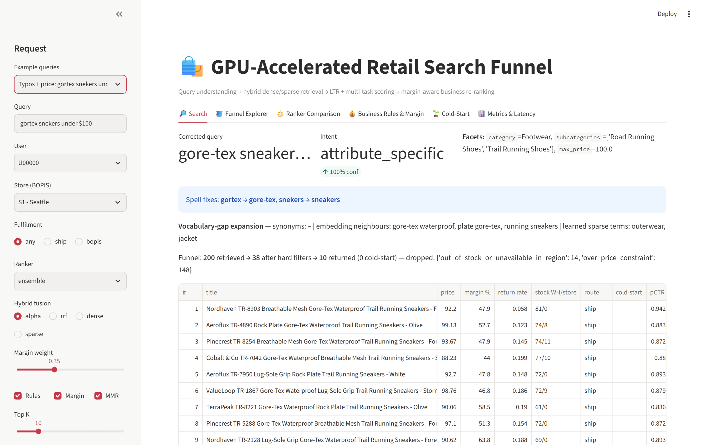

# Retail ML Search Funnel

GPU-accelerated multi-stage retail search & ranking that optimises **expected revenue and gross margin**, not CTR.
Everything here is generated, trained, served and screenshotted from this repo (synthetic data; see *Limitations*).

```
query -> 1 Query understanding -> 2 Hybrid retrieval (N=200) -> 3 LTR + multi-task scoring -> 4 Business re-rank -> top-K
         spell, NER/intent,       BM25F + char n-gram + learned   8 LTR models + ensemble;     hard filters, penalties,
         synonym + embedding      expansion  +  bge-small          pCTR/pATC/pCVR/pReturn       margin optimiser, MMR
         expansion                multimodal vectors in FAISS
```

## Challenges addressed
| Reality | Solution |
|---|---|
| Vocabulary gap ("waterproof trail kicks" -> "Gore-Tex trail running sneakers") | SymSpell spell-fix on catalog vocab, curated synonym graph, embedding-neighbour terms, click-learned (SPLADE-style) sparse expansion, dense bge retrieval |
| Multi-objective | `E[profit] = pCTR * pATC|click * pCVR|cart * margin * (1 - pReturn)`; blended with relevance by the margin optimiser (a relevance floor stops irrelevant-but-profitable items) |
| Hard rules / regional stock | OOS and region/BOPIS filters, brand allow/deny, hard price caps (also parsed from "under $100"), soft penalties for high return rate, low stock, recently bought durables |
| Long tail / cold start | 15% of SKUs have zero history; they are indexed on text + synthetic image + tabular content fused into one vector space, and ranked from content/brand/price features |

## Quick start
```bash
pip install -r requirements.txt && python -m playwright install chromium
python scripts/run_pipeline.py --regen     # data -> index -> train -> evaluate (~2.5 min on an RTX 3090)
pytest -q tests/                            # 21 tests
uvicorn src.api.main:app --port 8000        # Swagger at /docs
streamlit run src/ui/app.py                 # UI
python scripts/capture_screenshots.py       # Playwright screenshots -> outputs/screenshots
```
`--small` gives a ~45 s smoke run (it overwrites `data/`; use `--regen` afterwards for the full run).

## Layout
`src/data_gen` generator, `src/query_understanding`, `src/retrieval`, `src/ranking` (features, 8 LTR models, multi-task heads), `src/reranking`, `src/evaluation`, `src/api`, `src/ui`, `src/engine.py` (stages 1-2), `src/search_service.py` (full funnel), `configs/config.yaml`, `outputs/{models,metrics,logs,screenshots}`.

## Data (12,000 SKUs, 2,000 users, 1M impressions)
19 product types over 7 categories, 18 brands in 3 tiers, 1,779 cold-start SKUs, 5 stores + online warehouse with per-SKU stock, 3,000 colloquial/typo/navigational/formal queries, and a 100k-session Impression -> Click -> Cart -> Purchase -> Return log (25.5% CTR; 85.7k purchases; 14.1k returns). About 8% of SKUs have *misleading titles* (they claim a feature they lack): they attract clicks but get returned more. Ground truth comes from a latent model kept in `catalog_latent.parquet`, used only by evaluation.

## Results (test split, synthetic data)
**Retrieval** (recall normalised by min(|relevant|, N); relevant = grade-3 and purchasable online; latency includes query understanding + encode)

| Retriever | R@50 | R@200 | Cold-start R@50 | Cold-start R@200 | p95 ms |
|---|---|---|---|---|---|
| Sparse (BM25F + char + learned) | 0.711 | 0.819 | 0.498 | 0.742 | 13.9 |
| Dense (bge-small + multimodal) | 0.751 | 0.848 | 0.522 | 0.769 | 14.2 |
| Hybrid RRF | 0.754 | 0.851 | 0.533 | 0.771 | 13.9 |
| Hybrid alpha=0.6 (tuned on val) | **0.764** | 0.849 | **0.541** | 0.767 | 14.4 |

**Ranking** (k=10; revenue/margin = expected value per page, position-discounted, from latent truth)

| Model | NDCG@10 (rel) | NDCG@10 (eng) | Exp. revenue | Exp. margin |
|---|---|---|---|---|
| Retrieval order (no LTR) | 0.854 | 0.689 | 118.0 | 43.2 |
| XGB pointwise (GPU) | 0.916 | 0.883 | 173.2 | 67.8 |
| LGBM pointwise | 0.894 | 0.880 | 170.8 | 66.3 |
| XGB pairwise (GPU) | 0.909 | 0.882 | 172.1 | 66.4 |
| LGBM LambdaMART | 0.897 | 0.879 | 168.7 | 65.0 |
| CatBoost YetiRank (GPU) | 0.895 | 0.873 | 165.0 | 62.8 |
| XGB listwise rank:ndcg (GPU) | 0.893 | 0.870 | 167.2 | 64.0 |
| ListNet (torch) | **0.927** | 0.881 | **180.2** | **69.1** |
| DCNv2 (torch) | 0.923 | 0.870 | 171.3 | 64.8 |
| **Ensemble** (default; top-4 by val NDCG) | 0.911 | **0.884** | 172.2 | 66.6 |

Differences between the learned models are small (single seed, 300 lists), so treat their ordering as noise; the gap to retrieval order is real.
Multi-task heads (test): pCTR AUC 0.854, pATC|click AUC 0.758, pCVR|cart AUC 0.668, pReturn correlation with latent 0.71.

**Re-ranking ablation** (ensemble ranker)

| Stage | NDCG@10 | Exp. revenue | Exp. margin | OOS in top-10 | Avg return prob |
|---|---|---|---|---|---|
| 1 ranker only | 0.911 | 172.2 | 66.6 | 4.5% | 0.155 |
| 2 + hard filters & penalties | 0.906 | 165.8 | 66.1 | 0% | 0.123 |
| 3 + margin-aware re-rank | 0.903 | 186.1 | 78.2 | 0% | 0.118 |
| 4 + MMR diversity (full funnel) | 0.900 | 185.3 | 77.8 | 0% | see `outputs/metrics/rerank_ablation.csv` |

Margin optimisation gives about +17% expected margin for about 0.8 pt NDCG; hard rules cost a little relevance but remove every unfulfillable result.

**Latency** (200 test queries incl. typos, ensemble, RTX 3090, faiss-cpu HNSW), ms

| Stage | p50 | p95 | p99 |
|---|---|---|---|
| Query understanding (incl. GPU encode) | 19.0 | 22.1 | 24.1 |
| Retrieval (sparse + dense + fuse) | 6.8 | 7.8 | 8.5 |
| Features | 1.0 | 1.2 | 1.3 |
| Ranking (4-model ensemble + 4 heads) | 37.5 | 41.5 | 42.9 |
| Re-rank | 1.5 | 3.4 | 3.6 |
| **Total** | **65.6** | **71.8** | **77.1** |

Within the 150 ms budget. The spec's "<10 ms" for query understanding holds only for the non-neural part (spell/NER/expansion take about 1 ms); the stage as a whole is about 19 ms because it includes the query embedding, so the configured budget is 30 ms.

## Screenshots (`outputs/screenshots/`)
Swagger: `01_swagger_overview.png`, `02_swagger_search_execute.png`. UI: `03`-`05` search (vocabulary gap, typo+price, office heels), `06` funnel explorer, `07` ranker comparison, `08` business rules & margin sweep, `09` cold-start, `10` metrics & latency. Real API responses: `sample_api_responses.json`.




## API
`POST /search` (query, user_id, store_id/zip_code, fulfillment any|ship|bopis, brand_allow/deny, price caps, ranker, fusion, alpha, margin_weight, rule toggles) returns results with a per-SKU score breakdown (dense cos, BM25, pCTR/pATC/pCVR/pReturn, expected revenue/profit, flags, fulfilment route), query understanding, funnel counts with drop reasons and a latency breakdown. Also `GET /health /models /metrics /users/sample`. Inference logs go to `outputs/logs/inference.jsonl`.

## Limitations
- **Synthetic data.** Labels come from a latent model, so absolute metrics are optimistic; focus on relative comparisons. Retrieval recall is easy on a small, clean catalog.
- **FAISS:** `faiss-gpu` has no Windows wheel, so HNSW runs on CPU (a GPU index is used automatically where available). Encoders, XGBoost, CatBoost and the torch rankers use CUDA with CPU fallback. LightGBM runs on CPU.
- **Image embeddings are synthetic** vectors aligned to subcategory/colour/material and projected into text space by ridge regression; `open_clip_torch` is not used by the pipeline.
- Sparse retrieval is a custom sparse-matrix BM25F (much faster than `rank_bm25`); the SPLADE-style expansion is click-learned term association, not a transformer MLM head.
- Multi-task heads are separate GPU XGBoost models, not a shared-bottom network.
- LTR targets are engagement stages (0-3) from simulated impressions; NDCG is reported against both graded relevance and engagement.
- The API serialises requests with a lock (shared torch/FAISS state); scale out with processes.
- XGBoost prints a harmless device-mismatch warning when predicting on CPU arrays with a CUDA booster.
